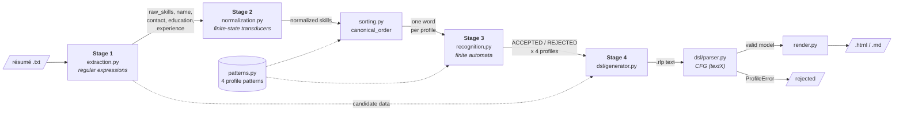

# Module design

## Architecture

ResumeLens is a pipeline. Each stage is one formal model and one module, and
it receives the output of the previous stage. The four professional profiles
are not separate implementations: they are data (`patterns.py`) that the same
code reads in Stages 2–4.



`pipeline.py` chains the stages and `main.py` is the command-line interface.
`profiles.py` (weighted classification) and the ranking part of `sorting.py`
were written before the recognition stage. They are kept and tested, but the
pipeline output is decided only by the automata, because the statement asks
ResumeLens **not** to rank candidates.

### Data that crosses each boundary

| Boundary | Type | Example (Wednesday Addams) |
|---|---|---|
| file → Stage 1 | `str` | `"Wednesday Addams\n\n3 years of experience ... JS, React.js, NodeJS, Postgres, Git."` |
| Stage 1 → Stage 2 | `dict`, key `raw_skills: list[str]` | `["JS", "React.js", "NodeJS", "Postgres", "Git"]` |
| Stage 2 → ordering | `list[str]` canonical names | `["JAVASCRIPT", "REACT", "NODE_JS", "POSTGRESQL", "GIT"]` |
| ordering → Stage 3 | `list[str]` in profile order, symbols of Σ only | Full Stack: `JAVASCRIPT REACT NODE_JS POSTGRESQL GIT` |
| Stage 3 → Stage 4 | `list[Recognition]` (4 items) | `FULL_STACK_DEVELOPER ACCEPTED`, the others `REJECTED` + missing blocks |
| Stage 4 generator → parser | `str` in the profile language | `candidate "Wednesday Addams" { ... }` |
| parser → render | textX model | `model.profiles.results[0].status == "ACCEPTED"` |
| render → file | `str` HTML / Markdown | `data/output/wednesday_addams.html` |

## Modules

| Module | Function | Input | Output |
|---|---|---|---|
| `extraction.py` | `extract(text)` | résumé text | `dict` with `name`, `contact`, `experience`, `education`, `qualifications`, `raw_skills` |
| | `extract_file(path)` / `save_json(data, path)` | path / dict | dict / JSON file |
| `normalization.py` | `normalize_skill(skill)` | one raw string | canonical name, `ValueError` if unknown |
| | `normalize_skills_safe(raw_skills)` | `list[str]` | `(normalized, unknown)` |
| | `QualificationTransducer(name, transitions).process(s)` | string | `(accepted, output)` |
| `patterns.py` | `PATTERNS`, `get_pattern(key_or_title)` | profile key or title | `ProfilePattern` (blocks, `alphabet`, `regex()`) |
| `sorting.py` | `canonical_order(skills, profile)` | normalized skills, profile | word for that profile's automaton |
| | `canonical_orders(skills)` | normalized skills | `{profile_key: word}` for the 4 profiles |
| | `rank_candidates(candidates)` | `list[Candidate]` | ranked candidates with tiers (Stage 2C, not used by the pipeline) |
| `profiles.py` | `classify_candidate(skills)` | normalized skills | `(best Profile, all profiles with score)` (not used by the pipeline) |
| `recognition.py` | `build_enfa(pattern)` | `ProfilePattern` | pyformlang `EpsilonNFA` |
| | `build_dfa(pattern)` / `formal_definition(profile)` | pattern / profile | pyformlang DFA / `{Q, Σ, δ, q0, F}` |
| | `recognize(skills, profile)` | normalized skills, profile | `Recognition(word, accepted, trace, missing_blocks)` |
| | `recognize_all(skills)` / `accepted_profiles(skills)` | normalized skills | 4 `Recognition` / titles of accepted profiles |
| | `to_dot(profile)` / `export_diagrams(dir)` | profile / directory | Graphviz text / `.dot` files |
| `dsl/candidate.tx` | textX grammar | – | – |
| `dsl/generator.py` | `to_dsl(extracted, normalized, recognitions)` | Stage 1–3 outputs | profile text (`.rlp`) |
| `dsl/parser.py` | `parse(text)` / `parse_file(path)` | profile text / path | textX model, `ProfileError(kind, line, col)` if invalid |
| | `validate(text)` | profile text | `(True, None)` or `(False, message)` |
| `render.py` | `render(text, fmt)` / `render_file(src, dst, fmt)` | valid profile text, `"html"` or `"md"` | HTML / Markdown |
| | `to_html(model)` / `to_markdown(model)` | textX model | HTML / Markdown |
| `pipeline.py` | `process_text(text)` / `process_file(path)` | résumé | `PipelineResult` (all intermediate results + model or error) |
| | `write_outputs(result, out_dir, stem, formats)` | result | `.json`, `.rlp`, `.html`, `.md` paths |
| `main.py` | `main(argv)` | CLI arguments | console report + files, exit code |

## Command-line interface

```
python main.py [FILES ...] [--format html|md|both] [--out DIR] [--trace]
python main.py --validate PROFILE.rlp [...]
```

| Option | Effect |
|---|---|
| no files | processes every `.txt` in `data/resumes/` |
| `--format` | visualization to write (default both) |
| `--out` | output directory (default `data/output/`, ignored by git) |
| `--trace` | prints the state sequence of each automaton, e.g. `q0 -> LANGUAGE -> FRONTEND -> TRAP` |
| `--validate` | only checks `.rlp` files against the grammar; exit code 1 if any is invalid |

## Design decisions

1. **Profiles as data.** A new profile is a new `ProfilePattern`. The ordering,
   the automata and the visualization pick it up without new code (the
   grammar only needs the new key in `ProfileKey`).
2. **Ordering before recognition.** The automata read a word in canonical
   order. This keeps them small (one state per block) and makes the result
   independent of the order used in the résumé.
3. **Filter to Σ.** Qualifications outside the profile alphabet are removed
   before recognition, so an ML library does not make a Full Stack résumé fail.
4. **ε-NFA for modelling, DFA for running.** The ε-NFA is the direct
   translation of the `+`/`*` blocks. The DFA has readable states for the
   documentation and the trace. pyformlang checks that the two are equivalent.
5. **The grammar describes results, it does not recompute them.** The DSL
   stores what the previous stages produced. Consistency rules that a CFG
   cannot express are object processors (semantic errors).
6. **Invalid profiles are never rendered.** `render()` always parses first.
