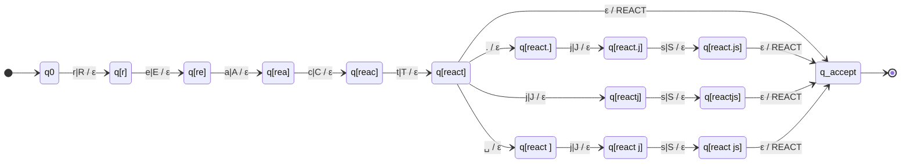
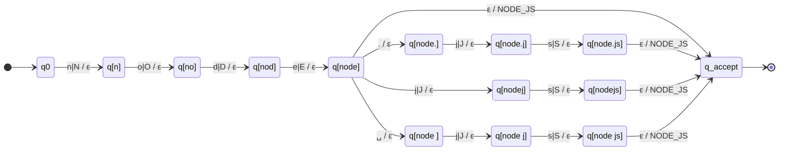
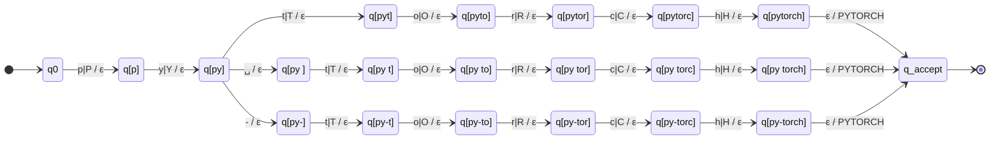

# Stage 2 — Qualification normalization with finite-state transducers

Module: `resumelens/normalization.py` · Tests: `tests/test_normalization.py`

## Scope

Stage 2 **transforms** raw skill strings (received from Stage 1, kept exactly as written) into
canonical form (uppercase, standardized). It does not decide whether a profile is satisfied (Stage 3).

**Input:** `raw_skills` list from Stage 1  
Example: `["JS", "React.js", "node.js", "Postgres", "py torch"]`

**Output** (`normalize_skills(raw_skills)` → `list[str]`):

| Key | Content |
|---|---|
| normalized skills | Canonical uppercase forms → **input to Stage 3** |

**API:**

| Function | Signature | Returns | Example |
|---|---|---|---|
| `normalize_skill(skill)` | `str → str` | Canonical form or raises `ValueError` | `"React.js"` → `"REACT"` |
| `normalize_skills(raw_skills)` | `list[str] → list[str]` | Normalized list or raises on first unknown | `["JS", "React.js"]` → `["JAVASCRIPT", "REACT"]` |
| `normalize_skills_safe(raw_skills)` | `list[str] → (list[str], list[str])` | `(normalized, unknown)`, no errors | `["JS", "BadTech"]` → `(["JAVASCRIPT"], ["BadTech"])` |

## Notation

A **finite-state transducer** (FST) is a 7-tuple `M = (Q, Σ, Γ, δ, ω, q0, F)`:

| Component | Meaning | Example |
|---|---|---|
| `Q` | Set of states | `{q0, q1, q_accept}` |
| `Σ` | Input alphabet (characters read) | `{a, b, ..., z}` |
| `Γ` | Output alphabet (characters emitted) | `{A, B, ..., Z, _}` |
| `δ` | Transition: `(state, input_char) → next_state` | `δ(q0, 'j') = q1` |
| `ω` | Output: `(state, input_char) → output_string` | `ω(q1, 's') = "AVASCRIPT"` |
| `q0` | Initial state | `q0` |
| `F` | Accepting states | `{q_accept}` |

**Execution:** Reads input character by character left-to-right. At each state and character,
follows the transition, emits output. Accepts (returns `True`) only if input is fully consumed
and machine is in an accepting state.

## Formal model

### `QualificationTransducer` class

```python
class QualificationTransducer:
    def __init__(self, name: str, transitions: Dict[Tuple[str, str], Tuple[str, str]])
    def formal_definition(self) -> Dict
    def process(self, input_str: str) -> Tuple[bool, str]
```

| Method | Purpose | Returns |
|---|---|---|
| `__init__` | Initialize FST with name and transition table. Infers `Q`, `Σ`, `Γ` from transitions. | — |
| `formal_definition()` | Return the complete 7-tuple `(Q, Σ, Γ, δ, ω, q0, F)` | `dict` |
| `process(input)` | Read input through FST state-by-state. | `(accepted: bool, output: str)` |

**Example:** JavaScript transducer processing `"javascript"`:

```
Input:   j a v a s c r i p t
State:   q0→q1→q2→...→q_accept
Output:  J A V A S C R I P T
Result:  (True, "JAVASCRIPT")
```

`QualificationTransducer` loads any transition table of this form into a `pyformlang.fst.FST`
and runs it with pyformlang's `translate`. The normalization transducers themselves are built
directly as pyformlang FSTs from the spelling table (next section).

## Transducers (pyformlang)

Every canonical qualification has its own transducer, built by `build_transducer` in
`resumelens/normalization.py` as a `pyformlang.fst.FST`. All of them have the same shape:

- **Q** — one state `q[p]` for every prefix `p` of a spelling (a trie), the initial state `q0` (empty prefix) and `q_accept`.
- **Σ** — the characters of the spellings in lower *and* upper case. The machine does the case folding itself: `δ(q, x) = δ(q, X)`.
- **Γ** — the canonical token(s), e.g. `{REACT}`.
- **δ** — reading a character goes from `q[p]` to `q[p·c]`; from the state of a complete spelling an ε-move goes to `q_accept`.
- **ω** — character moves write ε (nothing); the final ε-move writes the canonical token.
- **q0** — `q0`.   **F** — `{q_accept}`.

So the transducer is a relation `Σ* → Γ*` that translates every spelling of the class (in any letter case) into
the single canonical token, and has **no** translation for anything else (`translate` returns `[]` → *unknown skill*).

There are **64 transducers** (one per canonical token, 121 spellings).
`NORMALIZER` is their union: the same construction over every spelling, which gives one
**deterministic** FST (562 states, 1192 transitions) used at run time by `normalize_skill`.
Its determinism is checked in `tests/test_normalization.py`.

Below are the formal definitions and diagrams of the transducers for the assignment's examples.
Any other one can be printed with `formal_definition("<TOKEN>")`, drawn with `to_mermaid("<TOKEN>")`,
or exported with `write_dot("<TOKEN>", path)` (pyformlang `write_as_dot`). The `.dot` files of the six shown here
are in `docs/diagrams/`. In the diagrams `x|X / ε` means *read x or X, write nothing*, and `␣` is a blank space.

### JAVASCRIPT

Spellings: `js`, `javascript`

M_JAVASCRIPT = (Q, Σ, Γ, δ, ω, q0, F) where

- **Q** = {`q0`, `q[j]`, `q[ja]`, `q[js]`, `q[jav]`, `q[java]`, `q[javas]`, `q[javasc]`, `q[javascr]`, `q[javascri]`, `q[javascrip]`, `q[javascript]`, `q_accept`}
- **Σ** = {`a`, `A`, `c`, `C`, `i`, `I`, `j`, `J`, `p`, `P`, `r`, `R`, `s`, `S`, `t`, `T`, `v`, `V`}
- **Γ** = {`JAVASCRIPT`}
- **q0** = `q0`,  **F** = {`q_accept`}

| State | Input | δ (next state) | ω (output) |
|---|---|---|---|
| `q0` | `j` / `J` | `q[j]` | `ε` |
| `q[j]` | `a` / `A` | `q[ja]` | `ε` |
| `q[j]` | `s` / `S` | `q[js]` | `ε` |
| `q[ja]` | `v` / `V` | `q[jav]` | `ε` |
| `q[js]` | `ε` | `q_accept` | `JAVASCRIPT` |
| `q[jav]` | `a` / `A` | `q[java]` | `ε` |
| `q[java]` | `s` / `S` | `q[javas]` | `ε` |
| `q[javas]` | `c` / `C` | `q[javasc]` | `ε` |
| `q[javasc]` | `r` / `R` | `q[javascr]` | `ε` |
| `q[javascr]` | `i` / `I` | `q[javascri]` | `ε` |
| `q[javascri]` | `p` / `P` | `q[javascrip]` | `ε` |
| `q[javascrip]` | `t` / `T` | `q[javascript]` | `ε` |
| `q[javascript]` | `ε` | `q_accept` | `JAVASCRIPT` |

```mermaid
stateDiagram-v2
    direction LR
    state "q0" as s0
    state "q[j]" as s1
    state "q[ja]" as s2
    state "q[js]" as s3
    state "q[jav]" as s4
    state "q[java]" as s5
    state "q[javas]" as s6
    state "q_accept" as s7
    state "q[javasc]" as s8
    state "q[javascr]" as s9
    state "q[javascri]" as s10
    state "q[javascrip]" as s11
    state "q[javascript]" as s12
    [*] --> s0
    s0 --> s1 : j|J / ε
    s1 --> s3 : s|S / ε
    s3 --> s7 : ε / JAVASCRIPT
    s1 --> s2 : a|A / ε
    s2 --> s4 : v|V / ε
    s4 --> s5 : a|A / ε
    s5 --> s6 : s|S / ε
    s6 --> s8 : c|C / ε
    s8 --> s9 : r|R / ε
    s9 --> s10 : i|I / ε
    s10 --> s11 : p|P / ε
    s11 --> s12 : t|T / ε
    s12 --> s7 : ε / JAVASCRIPT
    s7 --> [*]
```



### REACT

Spellings: `react`, `react.js`, `reactjs`, `react js`

M_REACT = (Q, Σ, Γ, δ, ω, q0, F) where

- **Q** = {`q0`, `q[r]`, `q[re]`, `q[rea]`, `q[reac]`, `q[react]`, `q[react ]`, `q[react.]`, `q[reactj]`, `q[react j]`, `q[react.j]`, `q[reactjs]`, `q[react js]`, `q[react.js]`, `q_accept`}
- **Σ** = {`.`, `a`, `A`, `c`, `C`, `e`, `E`, `j`, `J`, `r`, `R`, `s`, `S`, `t`, `T`, `␣`}
- **Γ** = {`REACT`}
- **q0** = `q0`,  **F** = {`q_accept`}

| State | Input | δ (next state) | ω (output) |
|---|---|---|---|
| `q0` | `r` / `R` | `q[r]` | `ε` |
| `q[r]` | `e` / `E` | `q[re]` | `ε` |
| `q[re]` | `a` / `A` | `q[rea]` | `ε` |
| `q[rea]` | `c` / `C` | `q[reac]` | `ε` |
| `q[reac]` | `t` / `T` | `q[react]` | `ε` |
| `q[react]` | `␣` | `q[react ]` | `ε` |
| `q[react]` | `.` | `q[react.]` | `ε` |
| `q[react]` | `j` / `J` | `q[reactj]` | `ε` |
| `q[react]` | `ε` | `q_accept` | `REACT` |
| `q[react ]` | `j` / `J` | `q[react j]` | `ε` |
| `q[react.]` | `j` / `J` | `q[react.j]` | `ε` |
| `q[reactj]` | `s` / `S` | `q[reactjs]` | `ε` |
| `q[react j]` | `s` / `S` | `q[react js]` | `ε` |
| `q[react.j]` | `s` / `S` | `q[react.js]` | `ε` |
| `q[reactjs]` | `ε` | `q_accept` | `REACT` |
| `q[react js]` | `ε` | `q_accept` | `REACT` |
| `q[react.js]` | `ε` | `q_accept` | `REACT` |



### NODE_JS

Spellings: `node`, `node.js`, `nodejs`, `node js`

M_NODE_JS = (Q, Σ, Γ, δ, ω, q0, F) where

- **Q** = {`q0`, `q[n]`, `q[no]`, `q[nod]`, `q[node]`, `q[node ]`, `q[node.]`, `q[nodej]`, `q[node j]`, `q[node.j]`, `q[nodejs]`, `q[node js]`, `q[node.js]`, `q_accept`}
- **Σ** = {`.`, `d`, `D`, `e`, `E`, `j`, `J`, `n`, `N`, `o`, `O`, `s`, `S`, `␣`}
- **Γ** = {`NODE_JS`}
- **q0** = `q0`,  **F** = {`q_accept`}

| State | Input | δ (next state) | ω (output) |
|---|---|---|---|
| `q0` | `n` / `N` | `q[n]` | `ε` |
| `q[n]` | `o` / `O` | `q[no]` | `ε` |
| `q[no]` | `d` / `D` | `q[nod]` | `ε` |
| `q[nod]` | `e` / `E` | `q[node]` | `ε` |
| `q[node]` | `␣` | `q[node ]` | `ε` |
| `q[node]` | `.` | `q[node.]` | `ε` |
| `q[node]` | `j` / `J` | `q[nodej]` | `ε` |
| `q[node]` | `ε` | `q_accept` | `NODE_JS` |
| `q[node ]` | `j` / `J` | `q[node j]` | `ε` |
| `q[node.]` | `j` / `J` | `q[node.j]` | `ε` |
| `q[nodej]` | `s` / `S` | `q[nodejs]` | `ε` |
| `q[node j]` | `s` / `S` | `q[node js]` | `ε` |
| `q[node.j]` | `s` / `S` | `q[node.js]` | `ε` |
| `q[nodejs]` | `ε` | `q_accept` | `NODE_JS` |
| `q[node js]` | `ε` | `q_accept` | `NODE_JS` |
| `q[node.js]` | `ε` | `q_accept` | `NODE_JS` |



### POSTGRESQL

Spellings: `postgres`, `postgresql`

M_POSTGRESQL = (Q, Σ, Γ, δ, ω, q0, F) where

- **Q** = {`q0`, `q[p]`, `q[po]`, `q[pos]`, `q[post]`, `q[postg]`, `q[postgr]`, `q[postgre]`, `q[postgres]`, `q[postgresq]`, `q[postgresql]`, `q_accept`}
- **Σ** = {`e`, `E`, `g`, `G`, `l`, `L`, `o`, `O`, `p`, `P`, `q`, `Q`, `r`, `R`, `s`, `S`, `t`, `T`}
- **Γ** = {`POSTGRESQL`}
- **q0** = `q0`,  **F** = {`q_accept`}

| State | Input | δ (next state) | ω (output) |
|---|---|---|---|
| `q0` | `p` / `P` | `q[p]` | `ε` |
| `q[p]` | `o` / `O` | `q[po]` | `ε` |
| `q[po]` | `s` / `S` | `q[pos]` | `ε` |
| `q[pos]` | `t` / `T` | `q[post]` | `ε` |
| `q[post]` | `g` / `G` | `q[postg]` | `ε` |
| `q[postg]` | `r` / `R` | `q[postgr]` | `ε` |
| `q[postgr]` | `e` / `E` | `q[postgre]` | `ε` |
| `q[postgre]` | `s` / `S` | `q[postgres]` | `ε` |
| `q[postgres]` | `q` / `Q` | `q[postgresq]` | `ε` |
| `q[postgres]` | `ε` | `q_accept` | `POSTGRESQL` |
| `q[postgresq]` | `l` / `L` | `q[postgresql]` | `ε` |
| `q[postgresql]` | `ε` | `q_accept` | `POSTGRESQL` |

```mermaid
stateDiagram-v2
    direction LR
    state "q0" as s0
    state "q[p]" as s1
    state "q[po]" as s2
    state "q[pos]" as s3
    state "q[post]" as s4
    state "q[postg]" as s5
    state "q_accept" as s6
    state "q[postgr]" as s7
    state "q[postgre]" as s8
    state "q[postgres]" as s9
    state "q[postgresq]" as s10
    state "q[postgresql]" as s11
    [*] --> s0
    s0 --> s1 : p|P / ε
    s1 --> s2 : o|O / ε
    s2 --> s3 : s|S / ε
    s3 --> s4 : t|T / ε
    s4 --> s5 : g|G / ε
    s5 --> s7 : r|R / ε
    s7 --> s8 : e|E / ε
    s8 --> s9 : s|S / ε
    s9 --> s6 : ε / POSTGRESQL
    s9 --> s10 : q|Q / ε
    s10 --> s11 : l|L / ε
    s11 --> s6 : ε / POSTGRESQL
    s6 --> [*]
```



### SCIKIT_LEARN

Spellings: `scikit-learn`, `scikit learn`, `sklearn`, `sk-learn`

M_SCIKIT_LEARN = (Q, Σ, Γ, δ, ω, q0, F) where

- **Q** = {`q0`, `q[s]`, `q[sc]`, `q[sk]`, `q[sci]`, `q[sk-]`, `q[skl]`, `q[scik]`, `q[sk-l]`, `q[skle]`, `q[sciki]`, `q[sk-le]`, `q[sklea]`, `q[scikit]`, `q[sk-lea]`, `q[sklear]`, `q[scikit ]`, `q[scikit-]`, `q[sk-lear]`, `q[sklearn]`, `q[scikit l]`, `q[scikit-l]`, `q[sk-learn]`, `q[scikit le]`, `q[scikit-le]`, `q[scikit lea]`, `q[scikit-lea]`, `q[scikit lear]`, `q[scikit-lear]`, `q[scikit learn]`, `q[scikit-learn]`, `q_accept`}
- **Σ** = {`-`, `a`, `A`, `c`, `C`, `e`, `E`, `i`, `I`, `k`, `K`, `l`, `L`, `n`, `N`, `r`, `R`, `s`, `S`, `t`, `T`, `␣`}
- **Γ** = {`SCIKIT_LEARN`}
- **q0** = `q0`,  **F** = {`q_accept`}

| State | Input | δ (next state) | ω (output) |
|---|---|---|---|
| `q0` | `s` / `S` | `q[s]` | `ε` |
| `q[s]` | `c` / `C` | `q[sc]` | `ε` |
| `q[s]` | `k` / `K` | `q[sk]` | `ε` |
| `q[sc]` | `i` / `I` | `q[sci]` | `ε` |
| `q[sk]` | `-` | `q[sk-]` | `ε` |
| `q[sk]` | `l` / `L` | `q[skl]` | `ε` |
| `q[sci]` | `k` / `K` | `q[scik]` | `ε` |
| `q[sk-]` | `l` / `L` | `q[sk-l]` | `ε` |
| `q[skl]` | `e` / `E` | `q[skle]` | `ε` |
| `q[scik]` | `i` / `I` | `q[sciki]` | `ε` |
| `q[sk-l]` | `e` / `E` | `q[sk-le]` | `ε` |
| `q[skle]` | `a` / `A` | `q[sklea]` | `ε` |
| `q[sciki]` | `t` / `T` | `q[scikit]` | `ε` |
| `q[sk-le]` | `a` / `A` | `q[sk-lea]` | `ε` |
| `q[sklea]` | `r` / `R` | `q[sklear]` | `ε` |
| `q[scikit]` | `␣` | `q[scikit ]` | `ε` |
| `q[scikit]` | `-` | `q[scikit-]` | `ε` |
| `q[sk-lea]` | `r` / `R` | `q[sk-lear]` | `ε` |
| `q[sklear]` | `n` / `N` | `q[sklearn]` | `ε` |
| `q[scikit ]` | `l` / `L` | `q[scikit l]` | `ε` |
| `q[scikit-]` | `l` / `L` | `q[scikit-l]` | `ε` |
| `q[sk-lear]` | `n` / `N` | `q[sk-learn]` | `ε` |
| `q[sklearn]` | `ε` | `q_accept` | `SCIKIT_LEARN` |
| `q[scikit l]` | `e` / `E` | `q[scikit le]` | `ε` |
| `q[scikit-l]` | `e` / `E` | `q[scikit-le]` | `ε` |
| `q[sk-learn]` | `ε` | `q_accept` | `SCIKIT_LEARN` |
| `q[scikit le]` | `a` / `A` | `q[scikit lea]` | `ε` |
| `q[scikit-le]` | `a` / `A` | `q[scikit-lea]` | `ε` |
| `q[scikit lea]` | `r` / `R` | `q[scikit lear]` | `ε` |
| `q[scikit-lea]` | `r` / `R` | `q[scikit-lear]` | `ε` |
| `q[scikit lear]` | `n` / `N` | `q[scikit learn]` | `ε` |
| `q[scikit-lear]` | `n` / `N` | `q[scikit-learn]` | `ε` |
| `q[scikit learn]` | `ε` | `q_accept` | `SCIKIT_LEARN` |
| `q[scikit-learn]` | `ε` | `q_accept` | `SCIKIT_LEARN` |

```mermaid
stateDiagram-v2
    direction LR
    state "q0" as s0
    state "q[s]" as s1
    state "q[sc]" as s2
    state "q[sk]" as s3
    state "q[sci]" as s4
    state "q[sk-]" as s5
    state "q[skl]" as s6
    state "q[scik]" as s7
    state "q[sk-l]" as s8
    state "q[skle]" as s9
    state "q[sciki]" as s10
    state "q[sk-le]" as s11
    state "q[sklea]" as s12
    state "q_accept" as s13
    state "q[scikit]" as s14
    state "q[sk-lea]" as s15
    state "q[sklear]" as s16
    state "q[scikit ]" as s17
    state "q[scikit-]" as s18
    state "q[sk-lear]" as s19
    state "q[sklearn]" as s20
    state "q[scikit l]" as s21
    state "q[scikit-l]" as s22
    state "q[sk-learn]" as s23
    state "q[scikit le]" as s24
    state "q[scikit-le]" as s25
    state "q[scikit lea]" as s26
    state "q[scikit-lea]" as s27
    state "q[scikit lear]" as s28
    state "q[scikit-lear]" as s29
    state "q[scikit learn]" as s30
    state "q[scikit-learn]" as s31
    [*] --> s0
    s0 --> s1 : s|S / ε
    s1 --> s2 : c|C / ε
    s2 --> s4 : i|I / ε
    s4 --> s7 : k|K / ε
    s7 --> s10 : i|I / ε
    s10 --> s14 : t|T / ε
    s14 --> s18 : - / ε
    s18 --> s22 : l|L / ε
    s22 --> s25 : e|E / ε
    s25 --> s27 : a|A / ε
    s27 --> s29 : r|R / ε
    s29 --> s31 : n|N / ε
    s31 --> s13 : ε / SCIKIT_LEARN
    s14 --> s17 : ␣ / ε
    s17 --> s21 : l|L / ε
    s21 --> s24 : e|E / ε
    s24 --> s26 : a|A / ε
    s26 --> s28 : r|R / ε
    s28 --> s30 : n|N / ε
    s30 --> s13 : ε / SCIKIT_LEARN
    s1 --> s3 : k|K / ε
    s3 --> s6 : l|L / ε
    s6 --> s9 : e|E / ε
    s9 --> s12 : a|A / ε
    s12 --> s16 : r|R / ε
    s16 --> s20 : n|N / ε
    s20 --> s13 : ε / SCIKIT_LEARN
    s3 --> s5 : - / ε
    s5 --> s8 : l|L / ε
    s8 --> s11 : e|E / ε
    s11 --> s15 : a|A / ε
    s15 --> s19 : r|R / ε
    s19 --> s23 : n|N / ε
    s23 --> s13 : ε / SCIKIT_LEARN
    s13 --> [*]
```



### PYTORCH

Spellings: `pytorch`, `py torch`, `py-torch`

M_PYTORCH = (Q, Σ, Γ, δ, ω, q0, F) where

- **Q** = {`q0`, `q[p]`, `q[py]`, `q[py ]`, `q[py-]`, `q[pyt]`, `q[py t]`, `q[py-t]`, `q[pyto]`, `q[py to]`, `q[py-to]`, `q[pytor]`, `q[py tor]`, `q[py-tor]`, `q[pytorc]`, `q[py torc]`, `q[py-torc]`, `q[pytorch]`, `q[py torch]`, `q[py-torch]`, `q_accept`}
- **Σ** = {`-`, `c`, `C`, `h`, `H`, `o`, `O`, `p`, `P`, `r`, `R`, `t`, `T`, `y`, `Y`, `␣`}
- **Γ** = {`PYTORCH`}
- **q0** = `q0`,  **F** = {`q_accept`}

| State | Input | δ (next state) | ω (output) |
|---|---|---|---|
| `q0` | `p` / `P` | `q[p]` | `ε` |
| `q[p]` | `y` / `Y` | `q[py]` | `ε` |
| `q[py]` | `␣` | `q[py ]` | `ε` |
| `q[py]` | `-` | `q[py-]` | `ε` |
| `q[py]` | `t` / `T` | `q[pyt]` | `ε` |
| `q[py ]` | `t` / `T` | `q[py t]` | `ε` |
| `q[py-]` | `t` / `T` | `q[py-t]` | `ε` |
| `q[pyt]` | `o` / `O` | `q[pyto]` | `ε` |
| `q[py t]` | `o` / `O` | `q[py to]` | `ε` |
| `q[py-t]` | `o` / `O` | `q[py-to]` | `ε` |
| `q[pyto]` | `r` / `R` | `q[pytor]` | `ε` |
| `q[py to]` | `r` / `R` | `q[py tor]` | `ε` |
| `q[py-to]` | `r` / `R` | `q[py-tor]` | `ε` |
| `q[pytor]` | `c` / `C` | `q[pytorc]` | `ε` |
| `q[py tor]` | `c` / `C` | `q[py torc]` | `ε` |
| `q[py-tor]` | `c` / `C` | `q[py-torc]` | `ε` |
| `q[pytorc]` | `h` / `H` | `q[pytorch]` | `ε` |
| `q[py torc]` | `h` / `H` | `q[py torch]` | `ε` |
| `q[py-torc]` | `h` / `H` | `q[py-torch]` | `ε` |
| `q[pytorch]` | `ε` | `q_accept` | `PYTORCH` |
| `q[py torch]` | `ε` | `q_accept` | `PYTORCH` |
| `q[py-torch]` | `ε` | `q_accept` | `PYTORCH` |




## Spelling table

### `NORMALIZATION_MAP` — the source the transducers are built from

A dictionary with ~120 entries listing every accepted spelling and its canonical form. It is **not** used
for lookup: `build_transducer` turns it into the transducers above, and `normalize_skill` runs the FST.

```python
NORMALIZATION_MAP: Dict[str, str] = {
    "js": "JAVASCRIPT",
    "javascript": "JAVASCRIPT",
    "react": "REACT",
    "react.js": "REACT",
    "postgres": "POSTGRESQL",
    ...
}
```

**Coverage** (~120 entries across categories):

| Category | Count | Examples (normalized form) |
|---|---|---|
| Programming languages | 8 | `JAVASCRIPT`, `PYTHON`, `JAVA`, `GOLANG`, `RUST`, `KOTLIN`, `SCALA`, `SQL` |
| Frontend frameworks | 7 | `REACT`, `ANGULAR`, `VUE`, `NEXT_JS`, `SVELTE`, `EMBER` |
| Backend frameworks | 6 | `NODE_JS`, `EXPRESS`, `DJANGO`, `FLASK`, `SPRING_BOOT`, `FAST_API` |
| Data science & ML | 11 | `PANDAS`, `NUMPY`, `SCIKIT_LEARN`, `TENSORFLOW`, `PYTORCH`, `KERAS`, `MATPLOTLIB`, `PYSPARK`, `SPARK` |
| Databases | 9 | `POSTGRESQL`, `MYSQL`, `MONGODB`, `REDIS`, `SQLITE`, `SQL_SERVER`, `ORACLE`, `CASSANDRA`, `ELASTICSEARCH` |
| Tools & platforms | 8 | `GIT`, `GITHUB`, `GITLAB`, `DOCKER`, `KUBERNETES`, `AWS`, `AZURE`, `GCP`, `JENKINS`, `AIRFLOW`, `KAFKA` |
| API & protocols | 4 | `REST`, `GRAPHQL`, `GRPC`, `SOAP` |
| Competencies | 8 | `MACHINE_LEARNING`, `DEEP_LEARNING`, `PREDICTIVE_MODELS`, `DATA_PROCESSING`, `ETL`, `CI_CD`, `DEVOPS` |

**Example alternations:**

| Input variations | Normalized output |
|---|---|
| `js`, `javascript`, `JavaScript`, `JAVASCRIPT` | `JAVASCRIPT` |
| `react`, `react.js`, `reactjs`, `react js` | `REACT` |
| `python`, `py`, `python3`, `python 3` | `PYTHON` |
| `postgres`, `postgresql` | `POSTGRESQL` |
| `py torch`, `pytorch`, `py-torch` | `PYTORCH` |
| `machine learning`, `machine-learning`, `ml` | `MACHINE_LEARNING` |

**Matching rules:**

1. **Case-insensitive:** the transducer reads both `j` and `J` with the same move, so `"JavaScript"`, `"javascript"` and `"JAVASCRIPT"` all reach `q_accept` and are translated to `"JAVASCRIPT"`. The input is not lowercased beforehand.
2. **Whole-string match:** a skill is translated only if the FST consumes all of it and ends in `q_accept` (no partial matching: `"react18"` stops in `q[react]` with input left and has no translation).
3. **Closed vocabulary:** Only skills in the table are recognized. Unknown technologies (e.g., `"ZephirLang"`) cause an error or are skipped depending on the API.

## Public API

### `normalize_skill(skill: str) → str`

Normalize a single raw skill to its canonical form.

```python
normalize_skill("React.js")        # → "REACT"
normalize_skill("tensorflow")      # → "TENSORFLOW"
normalize_skill("UnknownTech")     # → ValueError: Unknown skill: UnknownTech
```

**Behavior:** Runs `NORMALIZER.translate(skill)` (pyformlang). Raises `ValueError` if the FST has no translation.

---

### `normalize_skills(raw_skills: List[str]) → List[str]`

Normalize a list of raw skills to canonical form, preserving order.

```python
normalize_skills(["JS", "React.js", "Postgres", "py torch"])
# → ["JAVASCRIPT", "REACT", "POSTGRESQL", "PYTORCH"]
```

**Behavior:** Applies `normalize_skill()` to each item in order. Raises `ValueError` on the first
unknown skill (all preceding skills are lost).

---

### `normalize_skills_safe(raw_skills: List[str]) → Tuple[List[str], List[str]]`

Normalize a list gracefully, collecting unknown skills separately instead of failing.

```python
norm, unknown = normalize_skills_safe(["JS", "BadTech", "Docker"])
# norm = ["JAVASCRIPT", "DOCKER"]
# unknown = ["BadTech"]
```

**Behavior:** Returns a tuple `(normalized, unknown)`. Unknown skills are skipped and reported,
not errors. All skills are attempted.

---

## Design decisions

1. **The transducers are generated from a table, not written by hand.**  
   Writing ~1,200 transitions by hand would be error-prone. The spellings are listed once in
   `NORMALIZATION_MAP` and `build_transducer` produces the pyformlang FSTs from it. Adding a
   spelling to the table adds its path to the transducer. Because the trie has one state per
   prefix, the union `NORMALIZER` is deterministic and runs in time linear in the input length.

2. **Case folding inside the transducer, whole-string matching.**  
   Upper- and lower-case letters share each transition, so case is handled by the formal model and
   not by preprocessing. A skill is translated only if it is consumed completely. This avoids the
   complexity of fuzzy matching or misspelling tolerance at this stage.

3. **Whitespace and punctuation are part of the key.**  
   Entries like `"react.js"`, `"react-js"`, and `"react js"` are separate spellings (separate paths in the transducer),
   all mapping to `"REACT"`. This is simpler than writing a regex for each technology.

4. **Closed vocabulary enforces consistency.**  
   Only ~120 pre-approved skills are recognized. Unknown technologies are rejected or collected.
   This prevents the pipeline from silently accepting misspellings or new technologies without
   updating the mapping.

5. **Order of appearance is preserved.**  
   `normalize_skills()` maintains the order of skills as they appear in `raw_skills`. Canonical
   ordering (by category or profile relevance) happens in later stages.

6. **Stage 1 → Stage 2 boundary is clean.**  
   Stage 1 keeps surface form; Stage 2 produces canonical form. Each stage has one responsibility.
   No normalization happens in Stage 1; no matching happens in Stage 2.

## Limitations

- **No contextual intelligence.** `"python"` always → `"PYTHON"`, even if the context suggests
  `"PYTHON_WEB"` vs. `"PYTHON_DATA"`. Disambiguation requires semantic analysis, not available here.

- **No fuzzy matching or spell-check.** `"pytohn"`, `"java scirpt"`, or `"nodee"` are rejected.
  Typo correction is not implemented.

- **Acronym ambiguity.** `"ML"` → `"MACHINE_LEARNING"` by default. If someone means `"Markup Language"`
  or `"Middle Layer"`, there is no way to tell.

- **Immutable and hardcoded mapping.** The table cannot grow or change at runtime. New technologies
  require code changes and redeployment.

- **No abbreviation expansion.** `"CICD"` and `"CI/CD"` are different keys; both must be listed
  if both spellings appear in résumés.

## Relationship to other stages

```
Stage 1: Extraction (Regex)
    Raw résumé text → ["JS", "React.js", "Postgres", ...]

Stage 2: Normalization (finite-state transducers, pyformlang)
    Raw skills → ["JAVASCRIPT", "REACT", "POSTGRESQL", ...]
    
Stage 3: Pattern Recognition (Finite automata)
    Normalized skills → Match against profiles
    → "Full Stack? Backend? ML Engineer?" → Accept/Reject

Stage 4: DSL Output (Context-free grammar)
    Accept/Reject → Validated candidate profile (textX)
```

**Input from Stage 1:** `raw_skills` (order preserved, surface form)  
**Output to Stage 3:** Normalized list (canonical form, order preserved)


