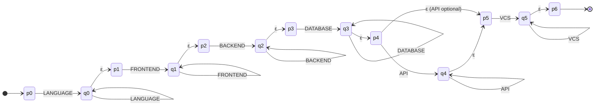
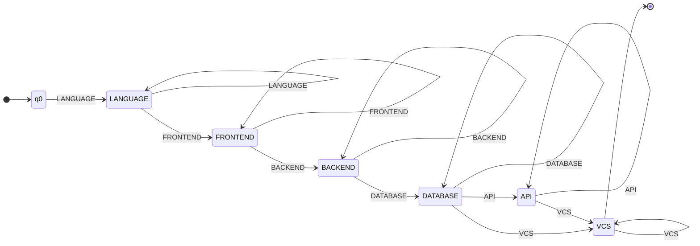
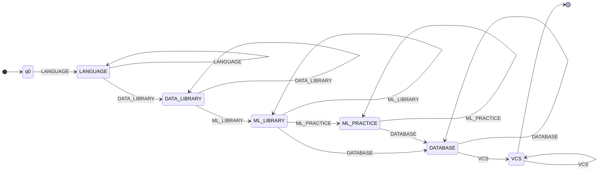
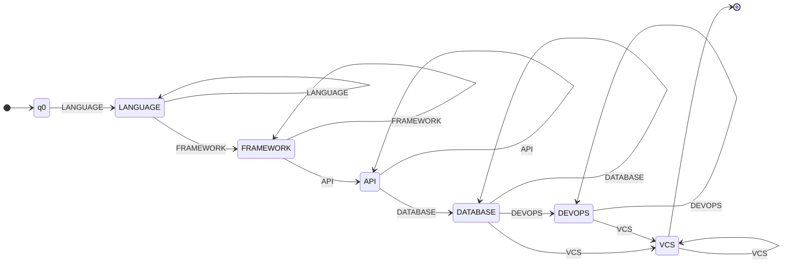
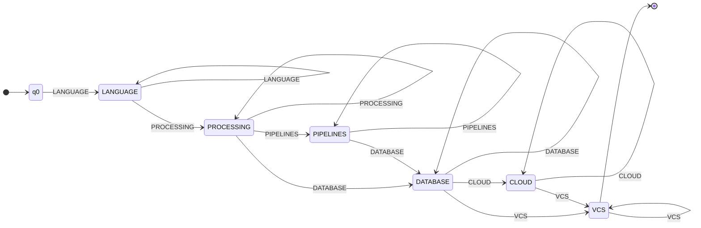

# Stage 3 — Qualification pattern recognition with finite automata

Module: `resumelens/recognition.py` · Patterns: `resumelens/patterns.py` · Tests: `tests/test_recognition.py`

## Scope

**Input:** normalized qualifications from Stage 2, e.g. `[GIT, NODE_JS, JAVASCRIPT, POSTGRESQL, REACT]`.

**Output:** for each of the four profiles, `ACCEPTED` or `REJECTED`, plus the
word that was read, the state trace and the required blocks that are missing.
A candidate may be accepted by several profiles or by none. Nothing is scored
or ranked: the only question is whether the word belongs to the profile language.

```python
from resumelens.recognition import recognize, accepted_profiles

recognize(["PYTHON", "PANDAS", "TENSORFLOW", "POSTGRESQL", "GIT"], "MACHINE_LEARNING_ENGINEER").result
# 'ACCEPTED'
accepted_profiles(["JAVASCRIPT", "REACT", "NODE_JS", "POSTGRESQL", "GIT"])
# ['Full Stack Developer']
```

## One general solution for the four profiles

The statement asks for the four profiles to go through the same software, not
four separate implementations. Each profile is therefore **data**: a
`ProfilePattern` made of ordered blocks. A block groups qualifications that play
the same role and is either required (`+`, one or more) or optional (`*`, zero
or more). From a pattern the code derives, without any profile-specific code:

1. the alphabet Σ and the canonical order (Stage 2, `sorting.canonical_order`);
2. an ε-NFA (`build_enfa`), the literal translation of the pattern;
3. an equivalent DFA (`build_dfa`), the machine that runs the words.

| Profile | Block-level regular expression |
|---|---|
| Full Stack Developer | `LANGUAGE+ FRONTEND+ BACKEND+ DATABASE+ API* VCS+` |
| Machine Learning Engineer | `LANGUAGE+ DATA_LIBRARY+ ML_LIBRARY+ ML_PRACTICE* DATABASE+ VCS+` |
| Backend Developer | `LANGUAGE+ FRAMEWORK+ API+ DATABASE+ DEVOPS* VCS+` |
| Data Engineer | `LANGUAGE+ PROCESSING+ PIPELINES* DATABASE+ CLOUD* VCS+` |

Stage 2 already sorted the word in block order and removed the symbols outside
Σ, so the automaton only has to check that the blocks come in the right order
and that every required block is present.

## Type of automaton

### ε-NFA (construction)

For block *i* the construction uses a state `p_i` (before the block) and `q_i`
(inside it):

| Transition | Meaning |
|---|---|
| `p_i --s--> q_i` and `q_i --s--> q_i`, s ∈ block i | read one or more symbols of the block |
| `q_i --ε--> p_(i+1)` | leave the block |
| `p_i --ε--> p_(i+1)` (optional blocks only) | skip the block |

The start state is `p_0` and the accepting state is `p_n`. It is an **ε-NFA**
because δ is defined on ε (δ: Q × (Σ ∪ {ε}) → P(Q)): from `q_i` the machine can
stay or move to `p_(i+1)` without reading input. Full Stack, for example:



### DFA (execution)

`build_dfa` builds a machine with the initial state `q0` plus one state per
block, meaning *"the last qualification read belongs to this block"*. It is a
**DFA** because:

* every symbol of Σ belongs to exactly one block of the profile
  (`tests/test_ordering.py::test_blocks_are_disjoint`), so from any state each
  symbol leads to **at most one** state, which makes δ: Q × Σ → Q a function;
* there are no ε-transitions;
* there is exactly one initial state.

δ is partial. Missing pairs go to an implicit trap state (not drawn) that
rejects the rest of the word; adding the trap state makes δ total.
pyformlang confirms `is_deterministic()` for the four DFAs and
`dfa.is_equivalent_to(enfa)` for the four pairs (`tests/test_recognition.py`),
so the readable DFA recognizes exactly the language of the pattern.

**How δ is built.** From block *i* (q0 counts as *i* = −1), the DFA reads a
symbol of block *j* and moves to state *j* when *j = i* (same block again), or
when *j > i* and every block between *i* and *j* is optional. The accepting
states are the blocks after which all remaining blocks are optional. In the
four profiles the last block (`VCS`) is required, so F = {VCS}.

## Formal definitions

Each profile is a DFA M = (Q, Σ, δ, q0, F). In the δ tables a column stands for
*any* symbol of that block (all the symbols of a block behave the same), and ∅
is the trap state.

## Full Stack Developer

| Component | Value |
|---|---|
| Q | {q0, LANGUAGE, FRONTEND, BACKEND, DATABASE, API, VCS} |
| Σ | {JAVASCRIPT, TYPESCRIPT, REACT, ANGULAR, VUE, SVELTE, NEXT_JS, NODE_JS, EXPRESS, DJANGO, FLASK, FAST_API, SPRING_BOOT, RAILS, POSTGRESQL, MYSQL, SQL_SERVER, SQLITE, ORACLE, SQL, MONGODB, REDIS, CASSANDRA, ELASTICSEARCH, NOSQL, REST, GRAPHQL, GIT, GITHUB, GITLAB} |
| q0 | q0 |
| F | {VCS} |
| Type | DFA, built from an ε-NFA |

| Block | Mode | Qualifications |
|---|---|---|
| `LANGUAGE` | required (+) | JAVASCRIPT, TYPESCRIPT |
| `FRONTEND` | required (+) | REACT, ANGULAR, VUE, SVELTE, NEXT_JS |
| `BACKEND` | required (+) | NODE_JS, EXPRESS, DJANGO, FLASK, FAST_API, SPRING_BOOT, RAILS |
| `DATABASE` | required (+) | POSTGRESQL, MYSQL, SQL_SERVER, SQLITE, ORACLE, SQL, MONGODB, REDIS, CASSANDRA, ELASTICSEARCH, NOSQL |
| `API` | optional (*) | REST, GRAPHQL |
| `VCS` | required (+) | GIT, GITHUB, GITLAB |

| δ | LANGUAGE | FRONTEND | BACKEND | DATABASE | API | VCS |
|---|---|---|---|---|---|---|
| **q0** | LANGUAGE | ∅ | ∅ | ∅ | ∅ | ∅ |
| **LANGUAGE** | LANGUAGE | FRONTEND | ∅ | ∅ | ∅ | ∅ |
| **FRONTEND** | ∅ | FRONTEND | BACKEND | ∅ | ∅ | ∅ |
| **BACKEND** | ∅ | ∅ | BACKEND | DATABASE | ∅ | ∅ |
| **DATABASE** | ∅ | ∅ | ∅ | DATABASE | API | VCS |
| **API** | ∅ | ∅ | ∅ | ∅ | API | VCS |
| **VCS** | ∅ | ∅ | ∅ | ∅ | ∅ | VCS |



**Pattern.** The candidate must show a web language, at least one frontend
framework, a backend technology and a database, followed by version control.
REST/GraphQL is common but many résumés do not mention it explicitly (the
statement example `JS, React.js, NodeJS, Postgres, Git` does not), so `API` is
optional.

* Accepted: `JAVASCRIPT REACT NODE_JS POSTGRESQL GIT`, trace q0 → LANGUAGE → FRONTEND → BACKEND → DATABASE → VCS.
* Rejected: `JAVASCRIPT NODE_JS POSTGRESQL GIT`. From `LANGUAGE` there is no transition on a BACKEND symbol, because FRONTEND is required.

## Machine Learning Engineer

| Component | Value |
|---|---|
| Q | {q0, LANGUAGE, DATA_LIBRARY, ML_LIBRARY, ML_PRACTICE, DATABASE, VCS} |
| Σ | {PYTHON, PANDAS, NUMPY, SCIKIT_LEARN, TENSORFLOW, PYTORCH, KERAS, MACHINE_LEARNING, DEEP_LEARNING, PREDICTIVE_MODELS, POSTGRESQL, MYSQL, SQL_SERVER, SQLITE, ORACLE, SQL, GIT, GITHUB, GITLAB} |
| q0 | q0 |
| F | {VCS} |
| Type | DFA, built from an ε-NFA |

| Block | Mode | Qualifications |
|---|---|---|
| `LANGUAGE` | required (+) | PYTHON |
| `DATA_LIBRARY` | required (+) | PANDAS, NUMPY |
| `ML_LIBRARY` | required (+) | SCIKIT_LEARN, TENSORFLOW, PYTORCH, KERAS |
| `ML_PRACTICE` | optional (*) | MACHINE_LEARNING, DEEP_LEARNING, PREDICTIVE_MODELS |
| `DATABASE` | required (+) | POSTGRESQL, MYSQL, SQL_SERVER, SQLITE, ORACLE, SQL |
| `VCS` | required (+) | GIT, GITHUB, GITLAB |

| δ | LANGUAGE | DATA_LIBRARY | ML_LIBRARY | ML_PRACTICE | DATABASE | VCS |
|---|---|---|---|---|---|---|
| **q0** | LANGUAGE | ∅ | ∅ | ∅ | ∅ | ∅ |
| **LANGUAGE** | LANGUAGE | DATA_LIBRARY | ∅ | ∅ | ∅ | ∅ |
| **DATA_LIBRARY** | ∅ | DATA_LIBRARY | ML_LIBRARY | ∅ | ∅ | ∅ |
| **ML_LIBRARY** | ∅ | ∅ | ML_LIBRARY | ML_PRACTICE | DATABASE | ∅ |
| **ML_PRACTICE** | ∅ | ∅ | ∅ | ML_PRACTICE | DATABASE | ∅ |
| **DATABASE** | ∅ | ∅ | ∅ | ∅ | DATABASE | VCS |
| **VCS** | ∅ | ∅ | ∅ | ∅ | ∅ | VCS |



**Pattern.** Python, a data library (Pandas/NumPy), at least one ML library
(scikit-learn or a deep-learning framework), an SQL database and version
control. Mentions of the practice itself (machine learning, predictive models)
are optional because they are usually written as free text. Only SQL engines
belong to `DATABASE`, since the statement lists *SQL* for this profile.

* Accepted (statement example): `PYTHON PANDAS TENSORFLOW POSTGRESQL GIT`.
* Rejected: `PANDAS TENSORFLOW SQL GIT`. There is no transition from q0 on PANDAS (no language).

## Backend Developer

| Component | Value |
|---|---|
| Q | {q0, LANGUAGE, FRAMEWORK, API, DATABASE, DEVOPS, VCS} |
| Σ | {JAVA, KOTLIN, PYTHON, GOLANG, CSHARP, RUST, JAVASCRIPT, TYPESCRIPT, NODE_JS, EXPRESS, DJANGO, FLASK, FAST_API, SPRING_BOOT, RAILS, REST, GRAPHQL, GRPC, SOAP, POSTGRESQL, MYSQL, SQL_SERVER, SQLITE, ORACLE, SQL, MONGODB, REDIS, CASSANDRA, ELASTICSEARCH, NOSQL, DOCKER, KUBERNETES, AWS, AZURE, GCP, CI_CD, JENKINS, DEVOPS, GIT, GITHUB, GITLAB} |
| q0 | q0 |
| F | {VCS} |
| Type | DFA, built from an ε-NFA |

| Block | Mode | Qualifications |
|---|---|---|
| `LANGUAGE` | required (+) | JAVA, KOTLIN, PYTHON, GOLANG, CSHARP, RUST, JAVASCRIPT, TYPESCRIPT |
| `FRAMEWORK` | required (+) | NODE_JS, EXPRESS, DJANGO, FLASK, FAST_API, SPRING_BOOT, RAILS |
| `API` | required (+) | REST, GRAPHQL, GRPC, SOAP |
| `DATABASE` | required (+) | POSTGRESQL, MYSQL, SQL_SERVER, SQLITE, ORACLE, SQL, MONGODB, REDIS, CASSANDRA, ELASTICSEARCH, NOSQL |
| `DEVOPS` | optional (*) | DOCKER, KUBERNETES, AWS, AZURE, GCP, CI_CD, JENKINS, DEVOPS |
| `VCS` | required (+) | GIT, GITHUB, GITLAB |

| δ | LANGUAGE | FRAMEWORK | API | DATABASE | DEVOPS | VCS |
|---|---|---|---|---|---|---|
| **q0** | LANGUAGE | ∅ | ∅ | ∅ | ∅ | ∅ |
| **LANGUAGE** | LANGUAGE | FRAMEWORK | ∅ | ∅ | ∅ | ∅ |
| **FRAMEWORK** | ∅ | FRAMEWORK | API | ∅ | ∅ | ∅ |
| **API** | ∅ | ∅ | API | DATABASE | ∅ | ∅ |
| **DATABASE** | ∅ | ∅ | ∅ | DATABASE | DEVOPS | VCS |
| **DEVOPS** | ∅ | ∅ | ∅ | ∅ | DEVOPS | VCS |
| **VCS** | ∅ | ∅ | ∅ | ∅ | ∅ | VCS |



**Team-defined profile (software engineering).** A backend developer builds
services: a server-side language, a backend framework, an explicit API style
(REST, GraphQL, gRPC, SOAP), a database and version control. Unlike Full Stack
the API block is **required** and there is no frontend block. DevOps tooling
(Docker, Kubernetes, CI/CD, cloud) is a plus, so it is optional.

* Accepted: `JAVA SPRING_BOOT REST POSTGRESQL DOCKER GIT`.
* Rejected: `JAVA SPRING_BOOT POSTGRESQL GIT`. From `FRAMEWORK` there is no transition on a DATABASE symbol.

## Data Engineer

| Component | Value |
|---|---|
| Q | {q0, LANGUAGE, PROCESSING, PIPELINES, DATABASE, CLOUD, VCS} |
| Σ | {PYTHON, SCALA, JAVA, SPARK, PYSPARK, KAFKA, AIRFLOW, ETL, DATA_PROCESSING, POSTGRESQL, MYSQL, SQL_SERVER, SQLITE, ORACLE, SQL, MONGODB, REDIS, CASSANDRA, ELASTICSEARCH, NOSQL, DOCKER, KUBERNETES, AWS, AZURE, GCP, GIT, GITHUB, GITLAB} |
| q0 | q0 |
| F | {VCS} |
| Type | DFA, built from an ε-NFA |

| Block | Mode | Qualifications |
|---|---|---|
| `LANGUAGE` | required (+) | PYTHON, SCALA, JAVA |
| `PROCESSING` | required (+) | SPARK, PYSPARK, KAFKA, AIRFLOW |
| `PIPELINES` | optional (*) | ETL, DATA_PROCESSING |
| `DATABASE` | required (+) | POSTGRESQL, MYSQL, SQL_SERVER, SQLITE, ORACLE, SQL, MONGODB, REDIS, CASSANDRA, ELASTICSEARCH, NOSQL |
| `CLOUD` | optional (*) | DOCKER, KUBERNETES, AWS, AZURE, GCP |
| `VCS` | required (+) | GIT, GITHUB, GITLAB |

| δ | LANGUAGE | PROCESSING | PIPELINES | DATABASE | CLOUD | VCS |
|---|---|---|---|---|---|---|
| **q0** | LANGUAGE | ∅ | ∅ | ∅ | ∅ | ∅ |
| **LANGUAGE** | LANGUAGE | PROCESSING | ∅ | ∅ | ∅ | ∅ |
| **PROCESSING** | ∅ | PROCESSING | PIPELINES | DATABASE | ∅ | ∅ |
| **PIPELINES** | ∅ | ∅ | PIPELINES | DATABASE | ∅ | ∅ |
| **DATABASE** | ∅ | ∅ | ∅ | DATABASE | CLOUD | VCS |
| **CLOUD** | ∅ | ∅ | ∅ | ∅ | CLOUD | VCS |
| **VCS** | ∅ | ∅ | ∅ | ∅ | ∅ | VCS |



**Team-defined profile (AI/data).** A data engineer builds the pipelines that
feed analytics and ML: a data language (Python, Scala, Java), a processing or
orchestration tool (Spark, PySpark, Kafka, Airflow), a database and version
control. Explicit ETL/data-processing mentions and cloud platforms are optional.

* Accepted: `PYTHON SPARK AIRFLOW ETL POSTGRESQL AWS GIT`.
* Rejected: `PYTHON ETL POSTGRESQL GIT`. From `LANGUAGE` there is no transition on a PIPELINES symbol, because PROCESSING is required.

## Diagrams

The Mermaid diagrams above render on GitHub. Graphviz sources of the four DFAs
are generated with `recognition.export_diagrams()` into `docs/diagrams/`:

```bash
dot -Tpng docs/diagrams/automaton_full_stack_developer.dot -o full_stack.png
```

## Sample résumés

| Résumé | Word read by the accepting automaton | Accepted profiles |
|---|---|---|
| `wednesday_addams.txt` | `JAVASCRIPT REACT NODE_JS POSTGRESQL GIT` | Full Stack Developer |
| `mary_jane_watson.txt` | `PYTHON PANDAS NUMPY SCIKIT_LEARN TENSORFLOW SQL GIT` | Machine Learning Engineer |
| `peter_parker.txt` | `JAVASCRIPT TYPESCRIPT NODE_JS SPRING_BOOT REST MYSQL MONGODB NOSQL DOCKER GIT GITHUB` (Backend) | Full Stack Developer, Backend Developer |

Peter Parker lists scikit-learn, PyTorch and TensorFlow, but no Python and no
data library, so the ML automaton has no transition from q0.

## Limitations

* The automata only see the qualifications that Stages 1 and 2 recognized. A
  skill missing from the normalization table cannot satisfy a block.
* Blocks are sets. The language says nothing about years of experience or
  proficiency level, and one mention is enough.
* Stage 2 sorts the word, so real résumés always satisfy the order constraint.
  The automaton still rejects unsorted words (`test_wrong_order`), which keeps
  the model correct when it is used on its own.
