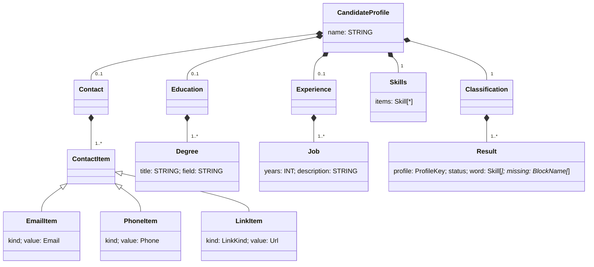

# Stage 4 — Candidate profile DSL

Grammar: `resumelens/dsl/candidate.tx` · Parser/validation: `resumelens/dsl/parser.py` ·
Generator: `resumelens/dsl/generator.py` · Visualization: `resumelens/render.py` ·
Tests: `tests/test_dsl.py` · Examples: `resumelens/dsl/examples/`

## Scope

**Input:** the structured information produced by the previous stages: the
candidate data extracted in Stage 1, the normalized skills from Stage 2 and the
four recognition results from Stage 3.

**Output:**

1. a candidate profile written in the ResumeLens profile language (`.rlp`),
2. its validation (the profile is accepted or rejected with a lexical, syntax or semantic error),
3. an HTML or Markdown visualization, generated only for valid profiles.

```
Stage 1-3 results ──generator.to_dsl──▶ profile.rlp ──parser.parse──▶ model ──render──▶ .html / .md
                                                         │
                                                         └─▶ ProfileError (rejected)
```

Example (`examples/valid/wednesday_addams.rlp`):

```
candidate "Wednesday Addams" {
    experience {
        3 years "developing web applications"
    }
    skills { JAVASCRIPT, REACT, NODE_JS, POSTGRESQL, GIT }
    profiles {
        FULL_STACK_DEVELOPER: ACCEPTED [JAVASCRIPT, REACT, NODE_JS, POSTGRESQL, GIT]
        MACHINE_LEARNING_ENGINEER: REJECTED missing [LANGUAGE, DATA_LIBRARY, ML_LIBRARY]
        BACKEND_DEVELOPER: REJECTED missing [API]
        DATA_ENGINEER: REJECTED missing [LANGUAGE, PROCESSING]
    }
}
```

## EBNF grammar

`?` = optional, `*` = zero or more, `+` = one or more, `|` = alternative,
quoted text = keyword, `/…/` = regular expression of a terminal.

```ebnf
profile        = "candidate" STRING "{" contact? education? experience? skills classification "}" ;

contact        = "contact" "{" contact_item+ "}" ;
contact_item   = "email" EMAIL
               | "phone" PHONE
               | link_kind URL ;
link_kind      = "linkedin" | "github" ;

education      = "education" "{" degree+ "}" ;
degree         = "degree" STRING ( "in" STRING )? ;

experience     = "experience" "{" job+ "}" ;
job            = INT year_unit STRING ;
year_unit      = "years" | "year" ;

skills         = "skills" "{" ( SKILL ( "," SKILL )* )? "}" ;

classification = "profiles" "{" result+ "}" ;
result         = profile_key ":" ( "ACCEPTED" "[" skill_list "]"
                                 | "REJECTED" ( "missing" "[" block_list "]" )? ) ;
skill_list     = SKILL ( "," SKILL )* ;
block_list     = BLOCK ( "," BLOCK )* ;
profile_key    = "FULL_STACK_DEVELOPER" | "MACHINE_LEARNING_ENGINEER"
               | "BACKEND_DEVELOPER" | "DATA_ENGINEER" ;

(* terminals defined by regular expressions *)
SKILL  = /[A-Z][A-Z0-9]*(_[A-Z0-9]+)*/ ;
BLOCK  = /[A-Z][A-Z_]*/ ;
EMAIL  = /[\w.%+-]+@[\w-]+(\.[\w-]+)+/ ;
PHONE  = /\+?\d[\d -]{5,}\d/ ;
URL    = /(https?:\/\/)?(www\.)?(linkedin|github)\.com\/(in\/)?[\w-]+/ ;
STRING = '"' { any character except '"' } '"' ;
INT    = digit { digit } ;
```

Whitespace and `// comments` are ignored between tokens.

## Terminals and non-terminals

| Non-terminal | Represents | textX rule |
|---|---|---|
| `profile` (start symbol) | one candidate | `CandidateProfile` |
| `contact`, `contact_item`, `link_kind` | contact section and its entries | `Contact`, `ContactItem` (`EmailItem` / `PhoneItem` / `LinkItem`), `LinkKind` |
| `education`, `degree` | academic records | `Education`, `Degree` |
| `experience`, `job`, `year_unit` | professional experience | `Experience`, `Job`, `YearUnit` |
| `skills` | normalized qualifications (Stage 2) | `Skills` |
| `classification`, `result`, `profile_key` | one result per profile automaton (Stage 3) | `Classification`, `Result`, `ProfileKey` |
| `skill_list`, `block_list` | comma-separated lists | textX repetition with separator `+=Skill[',']` |

| Terminal | Kind |
|---|---|
| `candidate contact education experience skills profiles email phone linkedin github degree in years year missing ACCEPTED REJECTED` and the four profile keys | keywords |
| `{ } [ ] : ,` | punctuation |
| `SKILL BLOCK EMAIL PHONE URL` | lexical classes defined by regular expressions (each one is a regular language) |
| `STRING INT` | textX built-in terminals |

## Structural characteristics

* **Hierarchical.** A profile is a block containing sections, and a section
  contains entries. The parse tree maps one-to-one onto Python objects (the
  textX model): `model.contact.items[0].value`, `model.profiles.results[1].missing`.
* **Fixed order of sections.** contact → education → experience → skills →
  profiles. `contact`, `education` and `experience` are optional, because
  Stage 1 does not always find them (Mary Jane's résumé has no contact data).
  `skills` and `profiles` are mandatory, since they are the output of
  Stages 2 and 3.
* **Repetition.** Several contacts, degrees, jobs and results (`+`), and
  comma-separated lists of skills and blocks. The skills list may be empty,
  for a résumé where nothing was recognized.
* **Alternatives that depend on a keyword.** After `ACCEPTED` the word read by
  the automaton is mandatory; after `REJECTED` the missing blocks are optional.
  The grammar enforces this, so `FULL_STACK_DEVELOPER: ACCEPTED` alone is a
  syntax error.
* **Typed tokens.** Emails, phones, profile links and canonical skills have
  their own terminals, so a malformed value is a lexical error instead of
  being accepted as free text.
* **Context-sensitive checks outside the grammar.** "A profile appears at most
  once", "no duplicated skills" and "every skill of an accepted word appears in
  the skills section" compare different parts of the tree. A context-free
  grammar cannot express them, so they are checked by textX object processors
  after parsing (semantic errors).

### Validation levels

| Level | Detected by | Example (`examples/invalid/`) |
|---|---|---|
| Lexical | regex terminals | `lexical_bad_email.rlp` (`wednesday@`), `lexical_lowercase_skill.rlp` (`python`) |
| Syntax | grammar rules | `syntax_missing_skills.rlp`, `syntax_unknown_profile.rlp` (`WEB_DESIGNER`), `syntax_accepted_without_word.rlp` |
| Semantic | object processors | `semantic_duplicate_profile.rlp`, `semantic_word_not_in_skills.rlp`, `semantic_zero_years.rlp` |

```python
>>> from resumelens.dsl.parser import validate
>>> validate(open("resumelens/dsl/examples/invalid/lexical_bad_email.rlp").read())
(False, 'lexical error (line 3, col 21): Expected Email')
```

textX reports lexical and syntax errors the same way (it is a scannerless PEG
parser). `parser.py` labels the error *lexical* when the parser was expecting
one of our regex terminals at that position.

## Simplification / Chomsky Normal Form (RAA3)

To show the simplification we take the core of the grammar, the `skills` and
`profiles` sections (the part produced by Stages 2 and 3), written as a plain CFG
G = (V, Σ, P, S). Keywords and tokens are terminals: `sk` = a SKILL, `bl` = a
BLOCK, `pk` = a profile key.

```
S  → K P
K  → skills { L } | skills { }
L  → sk | sk , L
P  → profiles { RS }
RS → R | R RS
R  → pk : ACCEPTED [ L ] | pk : REJECTED | pk : REJECTED missing [ M ]
M  → bl | bl , M
```

V = {S, K, L, P, RS, R, M},
Σ = {skills, profiles, ACCEPTED, REJECTED, missing, {, }, [, ], :, ",", sk, bl, pk}.

**1. ε-productions.** None. The empty skills list is written as its own
alternative `skills { }` instead of `L → ε`, so no nullable variables exist.

**2. Unit productions.** `RS → R` is the only one. It is replaced by the right
sides of R:

```
RS → R RS | pk : ACCEPTED [ L ] | pk : REJECTED | pk : REJECTED missing [ M ]
```

**3. Useless symbols.** Every variable derives a terminal string (L ⇒ sk,
M ⇒ bl, R ⇒ pk : REJECTED …) and every variable is reachable from S, so there is
nothing to remove.

**4. Terminals in long bodies.** Each terminal that appears in a body of length
≥ 2 gets its own variable:

```
A_sk → skills    A_pr → profiles   A_ac → ACCEPTED   A_rj → REJECTED   A_mi → missing
A_lb → {         A_rb → }          A_ls → [          A_rs → ]
A_co → :         A_cm → ,          A_k  → sk         A_b  → bl         A_p  → pk
```

**5. Bodies longer than 2.** They are split with new variables. Result, G in CNF
(every rule is `A → BC` or `A → a`):

```
S  → K P
K  → A_sk K1 | A_sk K2
K1 → A_lb K3            K3 → L A_rb            K2 → A_lb A_rb
L  → sk | A_k L1        L1 → A_cm L
P  → A_pr P1            P1 → A_lb P2           P2 → RS A_rb
RS → R RS | A_p R1
R  → A_p R1
R1 → A_co R2
R2 → A_ac R3 | REJECTED | A_rj R5
R3 → A_ls R4            R4 → L A_rs
R5 → A_mi R6            R6 → A_ls R7           R7 → M A_rs
M  → bl | A_b M1        M1 → A_cm M
A_sk → skills  A_pr → profiles  A_ac → ACCEPTED  A_rj → REJECTED  A_mi → missing
A_lb → {  A_rb → }  A_ls → [  A_rs → ]  A_co → :  A_cm → ,  A_k → sk  A_b → bl  A_p → pk
```

Example derivation in CNF of `skills { sk }`:
K ⇒ A_sk K1 ⇒ skills K1 ⇒ skills A_lb K3 ⇒ skills { K3 ⇒ skills { L A_rb ⇒ skills { sk A_rb ⇒ skills { sk }.

In CNF every derivation of a word of length n takes exactly 2n − 1 steps, and
the grammar can be parsed with CYK in O(n³). textX does not need this form
(it builds a PEG parser from the EBNF-like rules), so the CNF version
is a formal exercise. The `.tx` file keeps the readable form.

## textX meta-model



## Visualization

`render.render(text, "html" | "md")` parses the profile first. If the profile
is invalid it raises `ProfileError` and nothing is generated. Otherwise it
builds:

* **HTML**: a self-contained page (inline CSS, no external files) with name,
  contact links, education, experience, skills as chips and a table with the
  four automata results (green ACCEPTED / red REJECTED, the recognized word or
  the missing blocks). User text is HTML-escaped.
* **Markdown**: the same sections, readable on GitHub.

```python
from resumelens.render import render_file
render_file("resumelens/dsl/examples/valid/peter_parker.rlp", "data/output/peter_parker.html")
```

## Valid and invalid examples

| File | Result |
|---|---|
| `valid/wednesday_addams.rlp` | valid, Full Stack Developer accepted |
| `valid/mary_jane_watson.rlp` | valid, Machine Learning Engineer accepted (no contact section) |
| `valid/peter_parker.rlp` | valid, Full Stack + Backend accepted, all sections present |
| `invalid/lexical_bad_email.rlp` | lexical: `Expected Email` |
| `invalid/lexical_lowercase_skill.rlp` | lexical: `Expected Skill` |
| `invalid/syntax_missing_skills.rlp` | syntax: `Expected 'skills'` |
| `invalid/syntax_unknown_profile.rlp` | syntax: expected one of the four profile keys |
| `invalid/syntax_accepted_without_word.rlp` | syntax: `Expected '['` |
| `invalid/semantic_duplicate_profile.rlp` | semantic: profile reported twice |
| `invalid/semantic_word_not_in_skills.rlp` | semantic: accepted with skills not in the skills section |
| `invalid/semantic_zero_years.rlp` | semantic: years of experience must be positive |

All of them are checked by `tests/test_dsl.py`. The test fails if an invalid
example does not raise the error kind written in its name.
